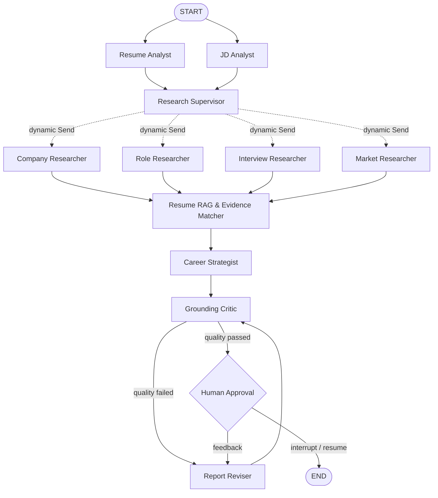

# OfferLens AI

> 用证据回答“我适合这个岗位吗？”——基于 LangGraph 的多智能体岗位分析与面试准备平台。

[](https://github.com/xzy5220/offerlens-agent/actions/workflows/ci.yml)


OfferLens 接收一份简历和一个岗位描述，由专业 Agent 团队并行完成简历解析、JD 拆解、公司与岗位研究、证据匹配、质量审查和面试计划，最终生成所有结论可回溯到简历原文或研究来源的求职报告。

它不是一个套了聊天界面的 Prompt Demo。核心流程使用 LangGraph 的并行分支、动态 `Send`、共享状态 reducer、反思循环、checkpoint 和 `interrupt/resume` 人工审批。

## 解决什么问题

普通求职助手经常给出“你很适合”“建议突出领导力”之类无法验证的结论。OfferLens 设置了两道硬约束：

1. 正向技能匹配必须引用简历原文；没有证据就只能标记为缺口或部分相关。
2. 公司与岗位研究必须保留来源；检索失败时明确降级，不能把模型猜测当事实。

最终输出包括：

- 0–100 岗位匹配分与逐项依据
- 已验证优势和优先能力缺口
- 公司、岗位、市场与面试研究摘要
- 不虚构经历的简历优化建议
- 针对岗位要求生成的面试问题与回答框架
- 7 天投递准备计划

## Agent 架构



详细的数据流、状态设计和失败策略见 [架构说明](docs/architecture.md)。

## 技术栈

| 层 | 实现 |
|---|---|
| Agent 编排 | LangGraph：并行节点、动态 fan-out、条件路由、循环、checkpoint、HITL |
| LLM 应用 | LangChain：统一模型接口、结构化输出、重试、文档切分、向量存储 |
| RAG | Resume chunking + `InMemoryVectorStore` + 本地可复现 Hash Embeddings |
| 在线推理 | OpenAI 兼容模型，通过 `init_chat_model` 切换；所有输出由 Pydantic 校验 |
| 搜索 | 离线 fixture、Tavily 或 DuckDuckGo 可插拔 provider |
| 后端 | FastAPI、SSE Agent 事件流、SQLite LangGraph checkpoint |
| 前端 | Next.js 16、React 19、TypeScript、响应式 Agent 工作台 |
| Agent 互操作 | MCP stdio server，暴露岗位提取与完整分析工具 |
| 质量 | pytest、离线回归数据集、证据覆盖率、引用覆盖率、LangSmith tracing |
| 工程化 | Docker Compose、GitHub Actions、Dependabot、ruff、mypy |

## 3 分钟本地启动

要求：Python 3.11+、Node.js 22+。默认演示模式不需要 API Key，也不联网。

### 1. 启动后端

```powershell
git clone https://github.com/xzy5220/offerlens-agent.git
cd offerlens-agent
py -3.11 -m venv .venv
.\.venv\Scripts\Activate.ps1
pip install -e ".[dev,mcp,search]"
Copy-Item .env.example .env
offerlens-api
```

API 文档位于 <http://127.0.0.1:8000/docs>。

### 2. 启动前端

```powershell
cd apps\web
npm install
Copy-Item .env.example .env.local
npm run dev
```

访问 <http://localhost:3000>，点击“载入演示数据”即可体验完整 Agent 流程。

### 3. Docker 启动

```bash
docker compose up --build
```

## 切换到真实模型和网络搜索

编辑根目录 `.env`：

```dotenv
OFFERLENS_MODE=live
OFFERLENS_MODEL=openai:gpt-4.1-mini
OFFERLENS_SEARCH_PROVIDER=tavily
OPENAI_API_KEY=your-key
TAVILY_API_KEY=your-key
LANGSMITH_TRACING=true
LANGSMITH_API_KEY=your-key
LANGSMITH_PROJECT=offerlens-agent
```

真实模型模式仍会经过确定性的 Evidence Matcher 和 Grounding Critic；模型不能修改程序计算出的匹配分、简历证据或来源列表。

## API 与实时事件

主要接口：

| Method | Endpoint | 用途 |
|---|---|---|
| `POST` | `/api/v1/analyses` | 使用简历文本创建分析 |
| `POST` | `/api/v1/analyses/upload` | 上传 PDF、DOCX、TXT 或 Markdown 简历 |
| `GET` | `/api/v1/analyses/{id}` | 查询报告与质量状态 |
| `GET` | `/api/v1/analyses/{id}/events` | SSE 实时 Agent 执行轨迹 |
| `POST` | `/api/v1/analyses/{id}/decision` | 恢复被人工审批中断的 LangGraph 线程 |

启用人工审批：

```dotenv
OFFERLENS_REQUIRE_APPROVAL=true
```

## MCP Server

OfferLens 可作为工具接入支持 MCP 的 Agent 客户端：

```json
{
  "mcpServers": {
    "offerlens": {
      "command": "D:/Agent/offerlens-agent/.venv/Scripts/offerlens-mcp.exe"
    }
  }
}
```

提供两个工具：`extract_job_requirements` 和 `analyze_job_fit`。

## Agent 评测

```powershell
pytest
offerlens-eval --dataset data/evals/career_cases.jsonl
```

评测不仅检查“输出像不像答案”，还检查技能与缺口召回率、证据覆盖、引用覆盖，以及简历建议是否包含虚构经历。数据格式和扩展方法见 [评测说明](docs/evaluation.md)。

## 项目结构

```text
offerlens-agent/
├── apps/web/                       # Next.js 可视化工作台
├── data/evals/                     # 可版本控制的 Agent 回归集
├── docs/                           # 架构、评测和学习文档
├── src/offerlens_agent/
│   ├── api/                        # FastAPI、SSE、运行管理
│   ├── domain/                     # Pydantic 领域模型
│   ├── evaluation/                 # 离线评测指标和 CLI
│   ├── services/                   # LLM、搜索、RAG、证据与质量门禁
│   ├── workflow/                   # LangGraph 状态和图
│   └── mcp_server.py               # MCP stdio server
├── tests/unit/                     # 领域与安全约束测试
├── tests/integration/              # Graph、HITL 和 API 测试
├── compose.yaml
└── langgraph.json                  # LangGraph Studio 入口
```

## 开源来源与独立改造

本项目以 LangChain 官方 [Open Deep Research](https://github.com/langchain-ai/open_deep_research) 为研究思路和初始 Git 历史来源，并遵循其 MIT 许可证。OfferLens 保留上游研究 Agent 作为对照，但产品领域模型、岗位工作流、简历 RAG、证据门禁、API、MCP、前端和评测集均为独立实现。

完整差异见 [UPSTREAM.md](UPSTREAM.md)。

## License

[MIT](LICENSE)
